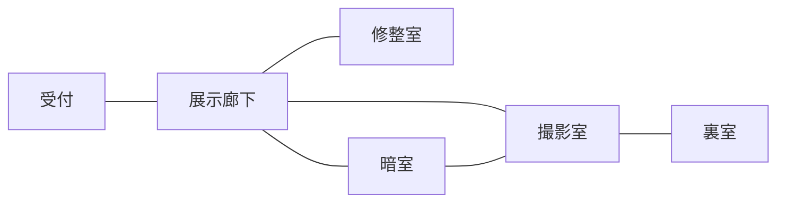

# 実装構成

## ファイル

| 場所             | 役割                                             |
| ---------------- | ------------------------------------------------ |
| src/data.ts      | 部屋、接写、操作座標、物、手掛かり、謎の定義     |
| src/engine.ts    | UIに依存しない進行と保存の検証                   |
| src/App.tsx      | 視点、持ち物、解錠・開蓋・取得、資料、各メニュー |
| src/Controls.tsx | 写真内の離散操作                                 |
| src/Photo.tsx    | 採用カタログからの画像参照・読み込み失敗表示     |
| src/audio.ts     | ユーザー操作で有効になる雨音・機構音             |
| src/assets.json  | 素材IDとファイルの対応                           |
| public/images    | 採用したWebPのみ                                 |
| docs/assets      | 容量・ハッシュ・生成指示                         |
| tests            | 進行の回帰テスト                                 |

## 状態の約束

「正解した」「蓋を開けた」「中身を拾った」を分離する。拾っていない物は収納に残る。2点入っている収納は、一点だけ取得した写真も用意する。

消耗する部品は設置先に記録する。再使用するハンドル・鋏・ガラス・写真は持ち物に残る。設置済みの物も参照できる。写真を開いた履歴そのものを正解条件には使わない。

入力は途中状態も保存する。正しくない入力で道具を失わない。ヒントや写真を開いても入力をリセットしない。

## 室内の接続

初回の廊下には受付の鍵、暗室には赤い糸の鍵を使う。裏室は幕を上げるまで入れない。訪問後の移動は館内メニューでも可能。

## 写真の管理

生成元の大きなシートは配信しない。決定版の各状態を切り出し、WebPへ変換する。背景、接写、持ち物、手掛かり、機構、結末で配置を分ける。カタログと実ファイルを照合し、旧版と未採用の素材を残さない。

謎の図柄は画像生成で制作し、任意の数字や線を後付けしていない。押せる範囲、選択枠、説明、方向移動はHTML/CSSで重ねる。写真の位置を動かしたら当たり判定も同時に更新する。

写真の向き・影・数が意図した論理に合わないときは、見た目だけを採用しない。画像、入力、ヒント、攻略資料、検証を一緒に修正する。

## 公開

バックエンド不要の静的アプリ。Viteのbaseを相対指定しているため、サブディレクトリでの配信にも対応する。公開作業・ドメイン設定はこの実装に含めていない。画像はブラウザが表示するものだけ順次読み込む。

Google Fontsが利用できない場合も、ローカルの明朝体・serifフォントで操作を続けられる。通信を完全に自前にする場合はフォントを同梱する。
